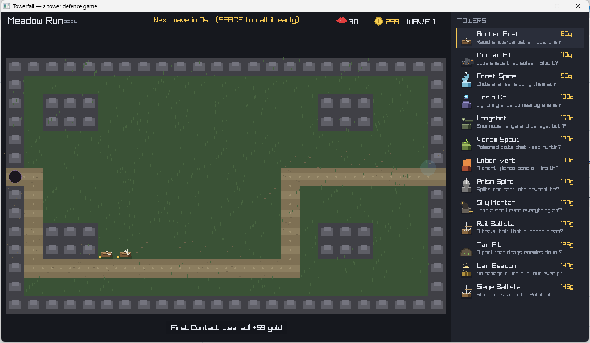
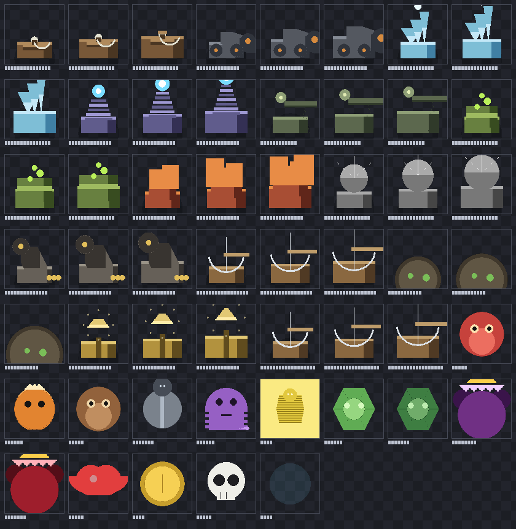

# 🏰 Towerfall

**A tower defence game where you can build anywhere — as long as you don't seal the path.**

Written in C++17 with raylib for the presentation and Lua for the content. The simulation is a
pure C++ library with no graphics, so it can be tested headlessly — and it is.

```bash
cmake -S . -B build -G "MinGW Makefiles" -DCMAKE_BUILD_TYPE=Release
cmake --build build -j4
./build/towerfall.exe          # → a window opens
```



---

## The idea

Most tower defence games protect the path: some tiles are reserved for it and you build
alongside. Towerfall lets you build **on the path itself** — and anywhere else — but the game
will refuse any placement that leaves no route from the entrance to your core.

That single rule changes how the game plays. Instead of a fixed lane you defend, the route is
something you *shape*. You can wall a corridor to force enemies into a kill zone, funnel them
past a cluster of Tesla coils, or pinch a gap to one tile wide — but the moment your wall
would seal the route completely, the game says no and shows you why.

```
"That would block the path completely."
```

It is checked honestly, by re-running the pathfinder with the hypothetical tower in place and
asking whether an enemy could still get through. Not by a hard-coded list of "protected" tiles.

## The enemies

Two families, and they behave completely differently.

**Walkers** follow the route and try to reach the core. They re-path around your towers, so
mazing works — as long as you leave a gap.

| Enemy | What it is |
|---|---|
| **Grunt** | The baseline. Slow, plentiful. |
| **Runner** | Fast and fragile. Arrives before your guns are ready. |
| **Brute** | Slow, armoured, hits like a truck. |
| **Crawler** | Very slow, very tough, and **ignores slows**. |
| **Wraith** | A ghost that walks through your slow effects untouched. |

**Attackers ignore the route entirely.** They walk straight at your towers and start hitting
them, which turns a good maze into a liability: the wall that was holding them at the choke
point is now the thing they are chewing through.

| Enemy | What it is |
|---|---|
| **Sapper** | The first tower-attacker. Fast, cheap, and enough to hurt. |
| **Bruiser** | Slow, armoured, and it takes a long time to kill your defences. |

**Flyers** are the third thing entirely: they ignore the path *and* your towers, flying straight
at the core. Mazing is useless against them; you need a tower that shoots up.

**Bosses** arrive every fifth wave. *Colossus* is a walking tank with a crown. *Ravager* is a
boss that attacks your towers instead of walking past them. Every tenth wave sends both.

## The towers

Twelve of them, each with three upgrade levels and a distinct sprite, all drawn by code.

| Tower | Role |
|---|---|
| **Archer Post** | Fast, cheap, single target. The opener. |
| **Mortar Pit** | Slow splash. Devastating to packs. |
| **Frost Spire** | Slows. Never kills fast, but makes everything else work. |
| **Tesla Coil** | Lightning that arcs between nearby enemies. |
| **Longshot** | Enormous range and damage, very slow reload. The boss answer. |
| **Venom Spout** | Damage over time. Best against high-HP single targets. |
| **Ember Vent** | Short, fierce, sets enemies on fire. |
| **Prism Spire** | Splits one shot into several piercing beams. |
| **Sky Mortar** | Lobs a shell over everything onto the far side. |
| **Siege Ballista** | Slow, colossal bolts. |
| **Tar Pit** | An aura that drags enemies down and chews on them. |
| **War Beacon** | No damage of its own, but every tower beside it hits 35% harder. |

Towers can be **destroyed** by attackers — and they mend between waves, so losing one costs you
but never spirals into an unwinnable state.

## Controls

| | |
|---|---|
| **Left click** a tower in the sidebar, then the map | Build it. The mode stays on, so you can place several. |
| **Left click** a built tower | Select it (shows its range and stats). |
| **U** / **X** | Upgrade / sell the selected tower. |
| **Space** | Call the next wave early. |
| **Tab** / **R** / **H** | Next level / restart / help. |
| **Right click** or **Esc** | Cancel. |
| **1**–**9**, **0** | Pick a tower by keyboard. |

## The sprites are generated, not drawn by hand

There are **no image files** in this project. Every tower, every upgrade level, every enemy and
every icon is rendered procedurally into a texture at startup:



Each drawing function works in a logical 64×64 space and scales its coordinates, so the same
code produces a crisp sprite at any size. The images are rendered at 4× and downsampled, which
is what gives the soft edges.

To regenerate the sheet:

```bash
./build/towerfall_sprites docs/sprites.png
```

This also **fails** if any sprite comes out blank, so a broken drawing routine cannot slip
through silently.

## Lua owns the content

The C++ core owns the simulation; **Lua owns the content** — the levels, the tower balance
table and the enemy roster. Change a number in `assets/content.lua` and the game changes, with
no recompile.

```lua
{
  id = "cannon", name = "Mortar Pit",
  description = "Lobs shells that splash. Slow to reload, devastating to packs.",
  mode = "splash",
  levels = {
    { cost = 110, damage = 26, range = 2.8, fireRate = 0.65, splashRadius = 1.2 },
    { cost = 95,  damage = 46, range = 3.1, fireRate = 0.75, splashRadius = 1.5 },
    { cost = 180, damage = 78, range = 3.5, fireRate = 0.85, splashRadius = 1.9 },
  },
},
```

The loader never throws: a missing file or a malformed table is reported as an error and the
game carries on with its built-in content.

## Building it

### What you need

| | |
|---|---|
| **CMake** | 3.20 or newer |
| **A C++17 compiler** | GCC 12+, Clang 15+, or MSVC 2019+ |
| **raylib 5.5** | ✅ vendored in `third_party/raylib-5.5` |
| **Lua 5.4** | ✅ vendored in `third_party/lua` |

**There is nothing else to install.** No `npm install`, no `vcpkg install`, no `apt install
raylib`, no package manager of any kind: the two third-party libraries are source trees in
`third_party/` and CMake builds them along with the game.

The only system packages you need are the ones raylib itself needs to open a window — the X11 /
Wayland / OpenGL development headers on Linux. Everything else is in the repository.

### Quick start

```bash
git clone <your-repo-url> towerfall
cd towerfall
cmake -S . -B build -DCMAKE_BUILD_TYPE=Release
cmake --build build -j"$(nproc 2>/dev/null || echo 4)"
./build/towerfall
```

That is the whole thing. The first build takes a minute or two because raylib is compiled from
source; after that, incremental builds are seconds.

### Windows (MinGW-w64)

```bash
cmake -S . -B build -G "MinGW Makefiles" -DCMAKE_BUILD_TYPE=Release
cmake --build build -j4
./build/towerfall.exe
```

You need a MinGW-w64 toolchain on your `PATH` — MSYS2's `mingw-w64-x86_64-gcc` package, or the
one that ships with Git for Windows (`C:\Program Files\Git\mingw64\bin`). Confirm it with
`g++ --version`.

**Visual Studio** works too, and is the easiest route on Windows:

```powershell
cmake -S . -B build -G "Visual Studio 17 2022" -A x64
cmake --build build --config Release
.\build\Release\towerfall.exe
```

### Linux

raylib needs the X11 and OpenGL headers:

```bash
sudo apt install build-essential cmake \
                 libx11-dev libxrandr-dev libxinerama-dev libxcursor-dev libxi-dev \
                 libgl1-mesa-dev
# (on Debian/Ubuntu; on Fedora: sudo dnf install gcc cmake \
#      libX11-devel libXrandr-devel libXinerama-devel libXcursor-devel libXi-devel mesa-libGL-devel)
cmake -S . -B build -DCMAKE_BUILD_TYPE=Release
cmake --build build -j"$(nproc)"
./build/towerfall
```

### macOS

```bash
brew install cmake
cmake -S . -B build -DCMAKE_BUILD_TYPE=Release
cmake --build build -j"$(sysctl -n hw.ncpu)"
./build/towerfall
```

### What the build produces

| Binary | What it is |
|---|---|
| `towerfall` | The game. |
| `towerfall_tests` | The headless test suite — no window, no GPU. |
| `towerfall_sprites` | Renders every sprite to a PNG sheet, and fails if any sprite is blank. |

### Build options

| Option | Default | What it does |
|---|---|---|
| `CMAKE_BUILD_TYPE` | `Release` | `Debug` builds are slower but easier to step through. |
| `BUILD_EXAMPLES` | `OFF` | raylib's own sample games. Never needed here. |
| `SUPPORT_MODULE_RAUDIO` | `OFF` | raylib's audio device support. The game is silent anyway. |

### Troubleshooting

**`undefined reference to stat64i32`** — you are linking a prebuilt raylib that was compiled
against the UCRT runtime while your toolchain targets `msvcrt`. This project builds raylib from
the vendored source, so this only happens if you point CMake at a system raylib. Delete the
`build/` directory and rebuild.

**`No rule to make target ... libraylib.a`** — an old `build/` directory cached a link against a
prebuilt library that no longer exists. `rm -rf build` (or `rmdir /s build` on Windows) and
configure again.

**`ld returned 1 exit status` with `cannot find -ldl`** — the Windows toolchain has no `libdl`.
The project links `dl` only on non-Windows platforms; if you see this, you are on Windows and
something has added it by hand.

**The window opens but is black** — the program crashed during startup. Run
`./build/towerfall` from a terminal to see the message; raylib prints the reason.

**`CMake` cannot find a compiler** — check `g++ --version` (or `cl`) works, and that CMake can
see it: `cmake -S . -B build -DCMAKE_CXX_COMPILER=g++`.

**Lua fails to compile on Windows** — `lua.h` pulls in `<sys/wait.h>` when `LUA_USE_POSIX` is
defined. The project only defines it on non-Windows platforms, so this means a stale CMake cache:
delete `build/` and reconfigure.

## Testing

```bash
./build/towerfall_tests          # 317 checks, no window needed
python tools/check_levels.py     # every route is walkable
./build/towerfall_sprites out.png  # every sprite has pixels
```

The test binary runs the **real simulation** — the same `Game` class the game uses — with no
window and no graphics. It proves the rules, not the drawing.

It covers, among other things:

- the placement rule: towers can be built **on** the path, and a placement that would seal the
  route is **refused** with a message that says so
- enemies walk the route and reach the exit; flyers ignore it; attackers go for towers
- towers kill things, and kills pay out
- an undefended game is **lost**
- a well-defended game is **won**
- every level's route is walkable and not drawn through a wall
- the Lua content loads, and a broken script fails safely

### Driving the real window

`tools/play.ps1` opens the actual game, builds towers by clicking, calls a wave and takes
screenshots — the end-to-end proof that a human can actually play it.

```powershell
powershell -File tools/play.ps1 -Exe build/towerfall.exe -Out docs
```

## Layout

```
src/
  core/          the simulation — pure C++, no graphics, no audio
    Types.h        geometry, terrain, tower and enemy enums
    Grid.h/cpp     the grid, A* pathfinding, the buildability rules
    Defs.h/cpp     the tower and enemy catalogue
    Waves.h/cpp    wave composition and pacing
    Levels.cpp     the three maps and their routes
    Game.h/cpp     the simulation: entities, waves, building, the economy
    Combat.cpp     movement, targeting, projectiles, damage, status effects
    LuaContent.*   loading levels and balance tables from Lua
  render/        presentation
    Sprites.cpp     procedural tower sprites
    SpritesEnemies.cpp procedural enemy sprites and icons
    Renderer.cpp    drawing everything, including the UI
  main.cpp       the game loop and input
tests/           the headless test suite
tools/           the level checker, the sprite sheet, the play harness
assets/
  content.lua    the levels, towers and enemies
third_party/
  raylib-5.5/    vendored raylib SOURCE — built by CMake
  lua/           vendored Lua SOURCE — built by CMake
```

### About `third_party/`

Both dependencies are **committed as source**, not as binaries, and CMake builds them along with
the game. That means a clone needs no network access and no package manager.

The `.gitignore` keeps the repository to a sensible size by excluding the parts of raylib that
are never built: its 56 MB of example games, its IDE project files, and its code generator.
That takes the checkout from 84 MB to about 16 MB while keeping everything the build needs.

The build directory is **not** in version control, so the first build on a fresh clone compiles
raylib from source. It takes a minute or two; after that, incremental builds are seconds.

The split matters: `core/` has no graphics dependency at all, which is why the rules can be
tested exhaustively and quickly. The renderer reads the simulation and never writes to it.

## Notes and limitations

- **There is no audio.** The game is silent. Sound would be the single biggest addition to the
  feel of it.
- **Enemies do not attack each other**, and there is no status-effect immunity beyond the
  slow-immune flag.
- **One level is a battle**, not a puzzle: the difficulty ramps over 15 waves, but the maps are
  hand-drawn rather than generated, and there is no endless mode.
- **The balance is judged by a scripted player**, not by real playtesting. The script spreads
  towers along the route and upgrades with surplus gold; a human will do better in places and
  worse in others.
- The wave reward was a `float` and printed as `+59.000000 gold` — found by *playing* the game,
  not by the tests.
